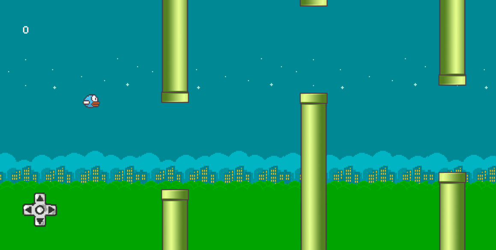

# Flappy MicBird

A simple Flappy bird with a twist. You can use the microphone to control the bird as well!  
This project was made using vanilla Javascript and Vue.js

You can see the project following [this link](https://flappy-micbird.netlify.app/)



## 🪛 Tools

- Vue.js
    - Vue Router
- Javascript
- Canvas API

## Running locally

To run the project in your machine take the following steps

1. Clone the repository
2. Open the terminal in project folder
3. Instal the dependencies with ```npm install```
4. Run with ```npm run serve```

You will have the project running in [localhost:5173](http://localhost:5173);